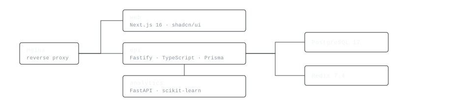

<picture>
  <source media="(prefers-color-scheme: dark)" srcset="assets/header-dark.svg">
  <source media="(prefers-color-scheme: light)" srcset="assets/header-light.svg">
  
</picture>

I build systems end to end — the interface, the API behind it, and the data model underneath. TypeScript and React in front, Node and Python behind, PostgreSQL, Redis and Docker under both.

### [seasmp](https://github.com/nyxeldev/seasmp) — education analytics platform

Three services in one monorepo, behind a single nginx: a **Next.js** client, a **Fastify + TypeScript** API, and a **Python FastAPI** service that scores student dropout risk from attendance and assessment history.

Prisma migrations on PostgreSQL 17, Redis for sessions and caching, an authenticated Socket.io gateway where room membership is derived from the token rather than trusted from the client, scheduled profile-refresh jobs, GitHub Actions CI that lints, tests and publishes images to GHCR, and a dependency-free load-test harness that measures what the detection layers cost under concurrency.

<picture>
  <source media="(prefers-color-scheme: dark)" srcset="assets/architecture-dark.svg">
  <source media="(prefers-color-scheme: light)" srcset="assets/architecture-light.svg">
  
</picture>

### Other work

- **[speaking-api](https://github.com/nyxeldev/speaking-api)** — FastAPI service for speaking practice: JWT auth, hashed credentials, a Telegram bot client, routes and services kept apart. Python.
- **[nextlearn](https://github.com/nyxeldev/nextlearn)** — Next.js App Router site for finding learning centres. Multi-page, animated, built on the file-system router.
- **[maxway-clone](https://github.com/nyxeldev/maxway-clone)** — food-delivery interface rebuilt from scratch in React: carousel, cart, i18n in three languages, MUI.

### Stack

```
languages   TypeScript · JavaScript · Python · SQL
frontend    React · Next.js · Tailwind · shadcn/ui · Redux
backend     Node.js · Fastify · FastAPI · Prisma · Socket.io · REST
data        PostgreSQL · Redis · pandas · NumPy
ops         Docker Compose · nginx · GitHub Actions · GHCR
```

### Elsewhere

[Telegram](https://t.me/alan_mid) · [YouTube](https://www.youtube.com/@frontend_with_hamidov) · [imhamidovic@gmail.com](mailto:imhamidovic@gmail.com)
